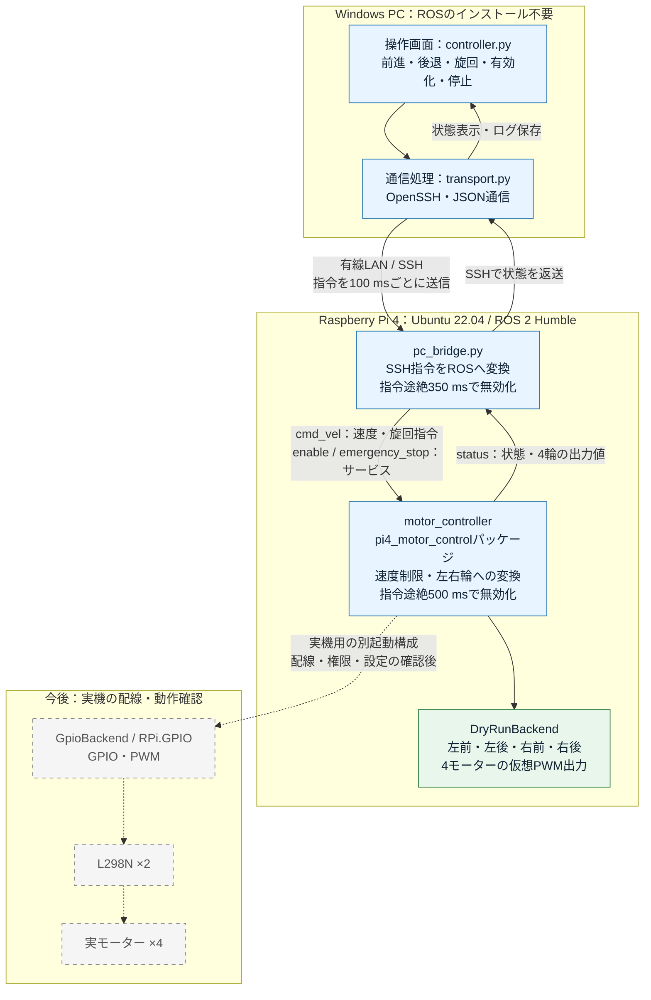

# 今回構築したROS 2環境

2026-10-28に構築・検証した構成。図の実線は実装・模擬動作検証済み、点線は実配線確認後に進める部分です。

- ROS 2はPi上で動作します。WindowsはPython/Tkの操作画面とSSHクライアントを使用します。
- PC操作は専用のROS_DOMAIN_ID=88と接続ごとの固有namespaceで動きます。
- PC用ブリッジはdry-run固定です。現在の画面から実モーター出力へ切り替える機能はありません。
- 起動時は無効。緊急停止解除や通信復旧だけでは再走行せず、再有効化が必要です。
- 350 ms / 500 msはソフトウェアの監視設定値であり、実際の停止時間の実時間保証ではありません。
- 状態として返す値は仮想PWM値で、エンコーダー等で計測した実速度ではありません。
- 単体16件、ROS統合、PC往復、GUI操作経路を検証済み。実GPIO出力・実車走行は未検証です。

関連資料：

- [PC起動・操作方法](../pc_controller/README.md)
- [ROSノード・実配線の準備](../ros2_ws/src/pi4_motor_control/README.md)
- [作業・デバッグ記録](../../前回の作業ログ/2026-10-28_モーター制御開発.md)
