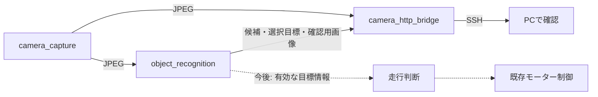

# 地面上の明部追従・画像認識仕様案

作成日：2026-11-02。対象：Raspberry Pi 4 / Logitech C310 / ROS 2 Humble。

2026-11-08追記：追尾対象を床の赤色レーザー光点へ具体化。
対象選択・微小光点の検出・画像内追跡については[赤色レーザー光点仕様](床の赤色レーザー光点・検出追跡仕様.md)を優先する。
従来の広い明部認識は実装済み機能として残し、レーザー専用認識器はこれから実装する。

**明部認識とPC表示の初期実装、および今後の拡張仕様を記載する。**
カメラ取得、下半分の明部抽出、目標の確定・消失、目標/確認用画像の配信、PC内の映像と赤線は実装済み。
初期認識器はBrightGroundDetector、モードはlight_spot。
ユーザー確定条件：地面は平坦・水平で、画像中央を水平線、下半分を地面と仮定する。
PC操作アプリの画像中央に赤い水平線を表示し、動作前に実際の水平線が一致するよう手動で取り付けを調整する。
今回の実装範囲は明部認識・結果配信・PCアプリ内の映像/赤線/結果表示。
実距離校正は別段階。画像座標による走行連携は[自動走行ノード仕様](自動走行ノード仕様.md)を参照。

## 1. 目的と対象

車両前方の**地面上にある明るい領域**を認識し、その目標座標を提供する。
走行判断側が目標の左右位置に応じて旋回し、将来的に目標へ近づけるようにする。

対象には次の2種類を設定で選ぶ。両者を自動的に同一視しない。

|モード|認識対象|制約|
|---|---|---|
|bright_region|周囲より明るい床面・地面上の明るい目印|白い床模様や反射も候補になり得る|
|light_spot|ライトで照らした、周囲との明暗差がある局所領域|光源そのものではなく、床面にできた照射領域を狙う|

初期実装は軽量な輝度解析・領域抽出・時間方向の照合を使い、AIモデルの学習を必須にしない。
最初は平坦な床と固定カメラでlight_spotを調整し、静止状態で検証する。

対象外：空や天井の明部、壁の照射点、窓、空中のライト本体、車体の映り込み。
ただし、明るさだけでこれらを完全に識別できるとはしない。
一般物体の種類を識別するAI、障害物検出、段差検出、経路計画は本認識機能の対象外。

## 2. 地面と判定するための前提

### 2.1 画像上の地面候補範囲（必須）

- カメラを車両へ固定し、前方の地面が見えるように設置する。
- 探索範囲は**画像の下半分（v >= 画像高さ/2）**に固定する。多角形の手動設定は不要。
- 画像中央の赤い水平線に実際の水平線を合わせてから動作させる。
- 初期実装は下半分の固定ROIと画像境界の除外。車体・車輪などの任意除外マスクは今後の拡張。
- 遠すぎる領域、車両直下で見えにくい領域、画面端の不安定な領域を必要に応じて除外する。
- 下半分を地面と扱うのは、平坦・水平な地面と手動での取付調整に基づく運用上の仮定。
- 認識領域がROI境界に大きくかかる場合は、重心だけが内側でも採用しない。

**ROIは地面と想定した画像範囲であり、そこに映る対象が本当に地面上にあるという証明ではない。**
ROI内に壁や障害物が入る場合、単眼の輝度解析だけでは排除できない。
地面上の対象だけを厳密に選ぶ必要がある場合は、深度・ステレオなど別の情報が必要。

### 2.2 地面上の実座標への変換（距離・到達判定に使用）

- カメラの歪みを校正し、床上の既知の点との対応から画像→地面の平面変換を求める。
- 実距離を使うため、床上の基準点はメートル単位の位置を測る。非共線の4点以上を使い、
  変換の作成に使わない追加点でも誤差を検証する。
- 平面変換が成立するのは、校正した床面・カメラ姿勢・解像度に対して。
  車体の傾き、坂、段差、取付位置の変更、画角変更では誤差が生じる。
- 校正の有効範囲外では実座標をnullとし、外挿した距離を使わない。
- 平面変換自体にも「その画素は床面を見ている」という前提があり、高さのある物体を識別する能力はない。
- 未校正の段階では画像上の左右位置を確認する。距離や到達をピクセルの上下位置だけで断定しない。

平面変換の根拠：[OpenCVのホモグラフィ解説](https://docs.opencv.org/3.4.19/d9/dab/tutorial_homography.html)。

## 3. ノードの責任分担

既に合意したカメラ側の3ノード構成を維持する。

|ノード|本仕様での責任|
|---|---|
|camera_capture|JPEG画像、入力時刻、カメラ状態の提供。認識・旋回判断はしない|
|object_recognition|地面ROI、明部候補の抽出、目標選択、座標・品質・有効性の提供|
|camera_http_bridge|画像・認識結果・確認用画像をPCへ渡す。走行判断はしない|

認識ノードはモーター指令を直接出さない。
将来の走行判断処理が認識結果を購読し、旋回・前進・停止を判断して既存モーター制御へ渡す。
その走行判断処理の配置・ノード名は、走行連携を実装するときに決める。

## 4. 入力と画像処理手順

入力は既存の`/camera/image/compressed`（sensor_msgs/msg/CompressedImage）。
最初は320×240を使う。最新フレームを処理し、入力キューを深さ1とする。

1. **入力検査**：JPEGの破損、入力時刻、画像サイズ、校正と設定の整合性を確認する。
2. **復号・前処理**：JPEGを画素へ展開し、輝度画像へ変換。小さなノイズを抑える。
   実座標を使う場合は歪み補正後の座標系へ統一する。
3. **地面範囲の適用**：多角形ROIと除外マスクを適用する。
4. **明部抽出**：絶対的な明るさと、近傍の背景に対する明暗差の両方を見る。
   light_spotでは局所的な明暗差を重視し、画像全体で一番明るい1画素だけを採用しない。
5. **領域化**：二値化、ノイズ除去、穴埋め、連結領域抽出で明部を面として扱う。
6. **候補の検査**：面積、ROI内占有率、明暗差、過度な白飛び、画面端との接触、
   周囲との分離度を評価する。全画面が明るい場合にも無理に目標を作らない。
7. **候補座標の算出**：矩形、領域面積、領域内の輝度重み付き重心を求める。
   重みは背景との差分から作り、重み合計が不足する場合は候補を無効にする。
8. **時間方向の確認**：連続した新しい入力フレームで同じ候補が続くかを確認する。
   同一フレームを繰り返し処理して確定回数を増やさない。
9. **目標選択**：下記の規則で1つを選ぶ。有効候補がない・選びきれない場合は選択目標なし。
10. **座標変換・配信**：画像座標を必ず配信し、床面校正が有効な場合のみ地面実座標と方位角も提供する。

二値化・領域抽出は[OpenCV公式のしきい値処理](https://docs.opencv.org/doc/doxygen/html/d7/d4d/tutorial_py_thresholding.html)を基礎にする。
各しきい値は実画像から調整し、現時点で環境に合う数値が確定したとは扱わない。

## 5. 目標の選択・保持・切り替え

- 初回取得：明暗差、適切な領域面積、時間的な安定性を評価して候補を順位付けする。
- 目標確定：原則として2枚以上の連続した新しい入力で条件を満たしてから確定する。
  この確認分の遅延も性能測定に含める。
- 複数候補：上位候補の評価差が小さく選択が曖昧な場合はambiguousとし、目標を有効にしない。
- 継続追従：前回位置との移動量・領域の重なりを使い、少し明るい別の候補へ毎回飛び移らない。
- 急な移動：許容範囲を超える座標飛びを検出したら、再確認が済むまで有効にしない。
- 平滑化：必要最小限に留め、遅延増加を測る。消失した目標を平滑化で残さない。
- ロスト：対象が消えたフレームでは選択目標を無効にする。
  内部の再対応付け用履歴を保存しても、過去座標を現在の走行目標として返さない。
- 再取得：再度確定条件を満たすまで無効。再取得したことと、走行を再開することは別に扱う。

候補スコアは0〜1の**品質指標**とし、物理的に地面である確率や認識正解率とは呼ばない。
暫定の追跡IDは、見た目の対応付けを示すだけで同一物体の厳密な証明ではない。

## 6. 座標の定義

### 6.1 画像座標（必須）

- 元画像左上が原点。uは右が正、vは下が正。単位はpx。
- `bbox_px`：領域を囲む左上座標と幅・高さ。
- `target_px`：選択した明部の輝度重み付き重心。矩形の中心とは限らない。
- `target_normalized`：u/画像幅、v/画像高さ。
- `horizontal_error` は認識出力から削除。自動走行ノードが `2*x_normalized-1` を計算する。
  image_center_uは光学中心が校正済みならその値、未校正なら画像幅/2を使う。
  負は画像左、正は画像右。歪み補正時は補正後の光学中心を使う。
- 校正済みの画像では、ROI・矩形・重心・表示用画像・平面変換もすべて補正後へ合わせる。
  `coordinate_space`でraw_image / rectified_imageを明示する。初期実装はraw_image。

horizontal_errorは画像上の左右差であり、そのまま車体の旋回角とはしない。
カメラが車体中央にない場合、画像の中央も車体の直進方向とは限らない。

### 6.2 車体基準の地面座標（校正後のみ）

- 車体の地面基準点を原点に、xは前方、yは左、zは上。単位はm。
  フレーム名は`base_ground`とし、モーターや将来のTFとの位置関係を実測して定義する。
- 地面上の選択目標は`(x_forward_m, y_left_m, 0)`。
- 方位角は`atan2(y_left_m, x_forward_m)`。正は左、負は右、単位rad。
- カメラの横ずれ・取付角も変換に含める。前方以外の点、変換不能な点、有効距離外の点は無効。
- 平面変換では領域の形が変わるため、実座標が必要なときはマスク内の点を地面へ変換して
  面積・輝度を考慮した目標を求める。画像重心を変換しただけの値と混同しない。
- 校正していなければ地面座標・距離・方位角はnullとする。

## 7. 出力インターフェース案

### 7.1 既存出力との関係

- `/vision/detections`：候補一覧の矩形・矩形中心を既存形式で提供する。
  既存のcenter_pxは矩形中心の意味を維持し、輝度重心へ置き換えない。
- `/vision/status`：処理状態・処理時間・エラーを提供し、実効認識fpsなどを拡張する。
- **新規案** `/vision/ground_target`（std_msgs/msg/String、JSON）：選択目標と有効性を提供する。
- **新規案** `/vision/debug/image/compressed`：対象入力にROI・候補・目標を重ねたJPEG。
  任意で生成し、表示負荷を抑えるため配信fpsを独立設定する。

新しい出力には、入力画像のstamp・frame_id、画像サイズ、設定/校正識別子を含める。
確認用画像には同じ入力stampを付け、別時刻の生画像へ矩形を重ねない。
確認用画像だけは復号後に描画・再圧縮が必要だが、生画像の転送経路は変更しない。

### 7.2 ground_targetの情報

|項目|内容|
|---|---|
|schema_version|結果形式の版。初期は1|
|state|waiting_for_image / searching / tracking / ambiguous / lost / stale / error / unconfigured|
|reason|未確定・候補なし・複数候補・校正不整合などの理由|
|target_valid|現在の入力に対して選択目標が有効か|
|source_frame|入力stamp・frame_id・幅・高さ・coordinate_space|
|mode|bright_region / light_spot|
|ground_basis|lower_half_assumption / calibrated_plane。どちらも深度による地面確認を意味しない|
|config_id / calibration_id|適用した設定・校正の識別子。未校正はcalibration_id=null|
|candidate_count|条件を満たした候補数|
|target|有効時のみ、追跡ID・bbox_px・target_px・target_normalized・品質指標・面積・平均輝度・局所明暗差|
|target.ground|有効な床面校正がある場合のみ地面座標・距離・方位角。それ以外はnull|
|processing_ms / result_stamp|処理時間と結果生成時刻。入力時刻と区別する|

target_valid=falseの場合は**target=null**とする。
候補のない正常処理と、認識未設定・エラーを区別する。
target_validは画像処理としての目標選択の有効性であり、走行可能・障害物なしを意味しない。
受信側も入力stampの鮮度を確認する。配信が止まれば、前回target_valid=trueでも期限切れになる。

HTTP側は既存`/results`の意味を維持し、新たな`/target`と`/debug/stream`で
選択目標と確認用映像を提供する案とする。PCへの組み込みは別作業。

## 8. 動作状態と走行側が利用する条件

|状態|選択目標|将来の走行判断側での扱い|
|---|---|---|
|searching|無効|確定するまで走行指令なし|
|tracking|有効|目標が新しく、別途追従が有効化されている場合のみ利用|
|ambiguous / lost|無効|停止・無効化。最後の旋回を維持しない|
|stale / error / unconfigured / waiting_for_image|無効|停止・無効化|

走行連携時の設計条件：

- 認識結果だけで走行を自動的に有効化しない。追従モードは明示的に有効化する。
- 画像上の右を、既存走行指令の右旋回へ対応付ける。既存の左正の旋回符号と混同しない。
- 中央付近に不感帯を設け、左右の振動を抑える。旋回量・変化率・走行速度に上限を設ける。
- 無効結果や通信途絶で停止した後は、再取得だけで走行を再開せず、再有効化を必要とする。
- 初期の試験は、認識座標・旋回要求値の表示とdry-runから行う。
- 前進・到達停止は、校正した距離や別の測距を使って別途仕様化する。
- 明部が見えることは、その場所まで走れることの証明にはならない。
  障害物・段差・走行可能領域の判断は追加情報として扱う。

ここでの停止規則は今後の連携仕様。既存モーター制御の指令期限や有効化機能が、
すでに認識結果に接続されているという意味ではない。

## 9. 応答時間と設定方針

以下は**開発目標**で、Pi上の達成済み性能ではない。

|項目|初期の目標・方針|
|---|---|
|画像入力|320×240・10fpsから開始|
|認識実行|最大10fps。現行の2fps設定から変更する案|
|1枚の認識処理時間|通常50ms以内を目標にし、中央値・95パーセンタイル・最大値を記録|
|入力JPEG受領→結果配信|95パーセンタイル150ms以内を初期目標とする|
|新規目標の確定|連続確認の待ち時間を別途含めて測定する|
|結果の期限|入力stampから300msを初期調整値とする。期限超過なら無効|
|古い画像|キューに蓄積しない。処理終了時にも鮮度を確認する|
|モーター同時動作|配信・認識・操作・制御を同時に動かして負荷と停止応答を測る|

入力stampはJPEG受領時刻であり、撮影前の待ち・露光・カメラ内処理は含まれない。
「照射位置が変わってから結果が変わるまで」の遅延は別途実験で測定する。
300msの期限や既存のモーター指令期限だけで、一定距離以内の停止を保証しない。
走行速度・制動性能・総遅延を測定し、到達距離や速度上限へ反映する。

初期調整用の設定項目：

- mode、ground_roi、exclusion_masks、設定/校正識別子。
- 絶対輝度下限、局所明暗差下限、背景評価範囲、白飛び比率の許容値。
- 最小/最大領域面積（画像やROIに対する比率）、ROI内占有率、ノイズ除去サイズ。
- 目標確定の連続フレーム数、候補評価差、追跡の最大移動量、平滑化係数。
- 認識fps、結果有効期限、確認用画像fps。

## 10. 誤認識を避けるための条件

- 自動露出で画面全体の明るさが変わるため、絶対輝度だけを使わない。
  設置環境を決めた後、カメラが対応する露出・ゲイン設定を確認し、固定できる場合は比較する。
- 白い床、鏡面反射、日光、複数ライトは誤検出要因として試験する。
- 全体が白飛びして領域が区別できない場合は、目標を有効にしない。
- ライト点灯前後の差分は、車両静止時または画像位置合わせが成立する場合の追加手段。
  走行中に単純な前後差分を取ると、背景の移動も照射変化と誤認するため必須方式にはしない。
- light_spotでも「人が操作したライトの照射点」とは確定できない。
  特定のライトだけを識別したければ、点滅パターン等を使う追加仕様を検討する。

## 11. 実装・受け入れ試験の順序

1. **録画・静止画像で試験**：上半分の明部を除外し、既知の候補マスクとの座標差を確認。
2. **Pi静止状態で試験**：地面へライトを左右に動かし、重心・追跡・消失時の無効化を確認。
3. **誤検出試験**：壁、窓、白い床模様、反射、2つの照射点、暗闇、白飛び、車体映り込みを含める。
4. **負荷・途絶試験**：画像停止、認識停止、破損JPEG、遅延、カメラ再接続、PC切断を試す。
   結果が止まった場合に購読側が期限で無効化できることも確認する。
5. **地面校正**：既知の位置で誤差を測り、距離・方位が使える範囲を定義する。
6. **走行dry-run**：左の照射点で左旋回要求、右で右旋回要求、中央で不感帯、
   目標無効・期限切れで停止になることを確認する。
7. **走行連携**：走行側の仕様・速度上限・停止条件を確定した後、段階的に実車検証する。

初期の受け入れ基準案：

- 正解マスクを用意した320×240の明瞭な単一照射領域で、重心誤差5px以内を目標にする。
  マスクによる輝度重心の定義を正解とし、目視でのライト中心と混同しない。
- ROI外の明部、曖昧な複数候補、入力停止では有効な走行目標を出さない。
- 消失後は次に処理した新しいフレームで無効化し、結果の配信停止時は購読側の期限で無効化する。
- 起動・再接続・目標再取得だけでモーター制御を有効化しない。
- 処理時間の目標達成だけでなく、場面ごとの検出率・誤検出率・遅延を記録する。
  必要な精度の最終基準は走行速度・床面・ライト条件を決めた後に確定する。

## 12. 実装前に決める項目

地面は平坦・水平、水平線は画像中央、手動でカメラを調整することを確定とする。
カメラ取付高さ・車体基準からの位置、床の材質、屋内/屋外、
照射点の想定距離・大きさ、複数候補時の方針、必要な応答時間、
到達したら停止するのかライトを追い続けるのかを決める。

これらが未確定でも、下半分を探索範囲とする静止車両で、画像上の候補位置を表示するところまでは実装できる。
自動走行と実空間座標の有効化は、必要な条件が確定・検証されてから進める。

## 13. 初期実装と検証の状況

- PillowとNumPyで明部を抽出し、周囲との明暗差から品質を評価する。
  2枚の新しい入力で確定し、同じstampの再配信では確定回数を増やさない。
- パラメーター初期値はbrightness_min=190、contrast_min=15、min_area_px=12、
  max_area_ratio=0.25、confirm_frames=2。環境に合わせた実ライトでの調整はこれから行う。
- 下半分以外、境界で切れた候補、過度な白飛び、複数候補の曖昧さを扱う。
  汎用の地面認識・障害物回避・実距離算出は実装しない。
- 目標JSONは/vision/ground_target、HTTPは/target。確認用画像は/vision/debug/image/compressed、
  HTTPは/debug/frame.jpgおよび/debug/stream。targetの期限は入力から300ms。
- PCは走行通信とは別のSSHトンネルで映像を受信し、中央赤線・目標座標を表示する。
  目標に応じた実モーターの旋回・前進は未接続。
- Piで26件の試験が合格。合成画像による上半分の除外、明部座標、確定、曖昧さ、
  消失、座標飛び、期限切れ、JPEG/HTTP配信を確認。
- PCで実SSH映像の埋め込みと中央赤線、モーター未接続での映像表示、画像停止時の消去を確認。
  映像受信と並行した既存GUIのドライラン操作・停止・フォーカス喪失・通信断の回帰試験も合格。
- 配信fpsは実カメラで10fpsを確認。認識処理時間とJPEG受領→結果生成は別に測定する。
  照射点が動いてから結果が変わるまで100ms以内かどうかは未検証。
- 待ち時間削減後の80件の参考測定では、認識処理の中央値57.67ms、95パーセンタイル60.65ms。
  JPEG受領→結果生成は中央値110.31ms、95パーセンタイル163.67ms、最大167.24ms。
  計測時の最終状態はambiguous。カメラの露光・USB転送前の処理・PC描画・目標確定待ちは別に評価する。
  50msの処理目標・150msの95パーセンタイル目標はこの測定では未達であり、今後の調整対象。
