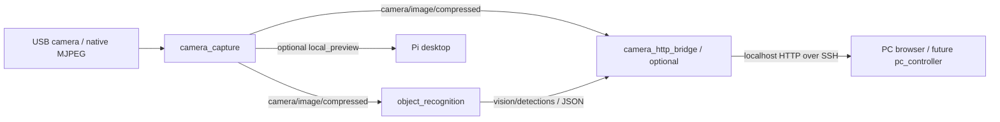

# Pi側カメラ・画像認識

USBカメラを1プロセスだけで取得し、表示と認識へ分配するROS 2 Humbleパッケージ。
初期設定では、画像下半分の明るい領域・ライト照射点を認識する。
PillowとNumPyによる輝度解析で、学習済みAIモデルは不要。
pc_controller内に映像と中央の赤い水平線、認識状態・目標座標を表示する。
左右方向・相対距離・速度は自動走行ノードが計算し、PCで自動走行を選択した場合に走行へ使用する。[自動走行仕様](../../../docs/自動走行ノード仕様.md)。

[地面上の明部・ライト照射点を追従する画像認識仕様](../../../docs/地面上の明部追従・画像認識仕様.md)に、
実装済みの機能と今後の床面校正・走行連携を区別して記載。
地面は平坦・水平と仮定し、動作前に画像中央の赤線へ実際の水平線を手動で合わせる。

## 構成



認識は別プロセスなので、認識処理の待ち時間がカメラ取得やHTTP表示を直接止めない。
ただし同じPiのCPU・メモリは共有する。重いモデルの負荷は別途実測が必要。
カメラのMJPEGを復号・再圧縮せず、そのままROSとHTTPへ渡す。既定は320×240・10fps、
認識は最大10fps、画像QoSはBEST_EFFORT・深さ1。古いフレームを積み上げない。
生画像は取得時に配信し、認識は入力到着時に開始する（設定fpsを超える入力は最新1枚に制限）。
認識用・確認用画像にはJPEGを復号し、確認用画像だけ再圧縮する。生画像の経路は再圧縮しない。

## ビルド・起動

Ubuntuの必要パッケージ（既に導入済みなら追加不要）：

```bash
sudo apt install ros-humble-sensor-msgs gstreamer1.0-tools \
  gstreamer1.0-plugins-base gstreamer1.0-plugins-good python3-numpy python3-pil
source /opt/ros/humble/setup.bash
cd ~/ros2-rove-one/ros2_ws
colcon build --packages-select pi4_camera_vision --symlink-install
source install/setup.bash
export ROS_DOMAIN_ID=88
ros2 launch pi4_camera_vision camera_vision.launch.py http_preview:=true
```

PiのGUIにも表示する場合は、Piのデスクトップのターミナルから
`local_preview:=true`を追加する。SSHからGUIを起動する場合は実際のDISPLAYとXAUTHORITYが必要。
GUIのない起動では既定のfalseを使う。終了はCtrl+C。
2026-11-06、ユーザーからカメラの自動起動を設定済みとの報告あり。
実際のサービス定義は未採取。[自動起動設定の記録](../../../environment/config/camera-autostart.md)を参照。
自動起動中は手動起動を重ねない。
バックグラウンド起動したカメラ一式の停止は
`python3 src/pi4_camera_vision/scripts/stop_camera.py`（ワークスペース直下から）。
同一ユーザーのカメラ関連プロセスだけを対象とし、モーターは対象にしない。

**旧`camera_ssh_preview.py`・Cheese・単独`camera-preview.sh`との同時起動はしない。**
カメラを奪い合うため、これらを終了してから起動する。

カメラは`config/camera.yaml`で設定。既定のby-idパスは実機C310用。
交換時は`ls -l /dev/v4l/by-id/`で確認し変更する。MJPEGに非対応のカメラは現状非対応。
解像度とfpsはそのカメラが対応する組み合わせを指定する。
設定は起動時のみ適用し、変更後は再起動する。

## ROSインターフェース

以下はルートnamespaceで起動した場合。モーター用の接続ごとのnamespaceには依存しない。
同一Piで複数台使う場合はnamespaceとHTTPポートをそれぞれ分け、設定ファイルのノード名も合わせる。

|配信元|トピック|型|内容|
|---|---|---|---|
|camera_capture|`/camera/image/compressed`|sensor_msgs/msg/CompressedImage|ネイティブJPEG、可変実効fps、BEST_EFFORT深さ1|
|camera_capture|`/camera/status`|std_msgs/msg/String|状態JSON、1Hz、RELIABLE深さ1|
|object_recognition|`/vision/detections`|std_msgs/msg/String|認識結果JSON、最大recognition_fps、RELIABLE深さ1|
|object_recognition|`/vision/status`|std_msgs/msg/String|認識状態JSON、1Hz、RELIABLE深さ1|
|object_recognition|`/vision/ground_target`|std_msgs/msg/String|選択目標と有効性、入力stamp、地面仮定、RELIABLE深さ1|
|object_recognition|`/vision/debug/image/compressed`|sensor_msgs/msg/CompressedImage|赤い水平線・候補枠・選択目標を重ねた同時刻のJPEG|

画像headerのstampは**Piが完全なJPEGを受領したROS時刻**。センサー露光時刻ではない。
結果の`frame.stamp`はその入力画像のheaderから引き継ぐ。frame_idは`camera_optical_frame`。
TFやCameraInfoはまだ配信しない。画像と結果を重ねるときはstampを照合する。
認識より表示fpsが高いため、現在の表示画像と最新の認識画像は同一とは限らない。

```bash
ros2 topic echo /camera/status
ros2 topic echo /vision/detections
ros2 topic hz /camera/image/compressed
```

認識結果の例（座標説明用の架空データ）：

```json
{
  "schema_version": 1,
  "state": "ok",
  "detector": "my_detector:Detector",
  "frame": {
    "stamp": {"sec": 123, "nanosec": 456},
    "frame_id": "camera_optical_frame", "width": 320, "height": 240
  },
  "detections": [{
    "label": "example", "confidence": 0.9,
    "bbox_px": {"x": 10, "y": 20, "width": 100, "height": 40},
    "center_px": {"x": 60, "y": 40},
    "center_normalized": {"x": 0.1875, "y": 0.1666666667}
  }],
  "processing_ms": 12.3, "error": ""
}
```

- 原点は画像左上、xは右、yは下。bboxは左上＋幅・高さ。すべて**元画像**のピクセル座標。
- 正規化中心座標はxを画像幅、yを画像高さで割った値。メートル座標・距離・追跡IDは提供しない。
- `ok`で空配列：設定済みの認識器が処理を完了し、閾値以上の対象なし。
- `recognition_disabled`：対象・認識器未設定。対象がなかったという意味ではない。
- `waiting_for_image`：画像未受信。`stale`：画像が期限切れ、または処理完了までに期限超過。
- `error`：認識器ロード失敗、処理例外、座標不正など。空配列とerror文字列を返す。
- stale/waiting時はframe=null・空配列。前回の座標を有効な結果として再配信しない。
- カメラ再接続中も状態を配信し、frame_timeout_sec後に取得をやり直す。reconnect_sec間隔で再試行。

## 認識器を後から実装する

`detector: package.module:Detector`を設定する。モジュールはPiのPythonからimportできる場所に配置し、
クラスは引数なしで初期化する。モデル読み込みは初期化時に行う。

```python
from pi4_camera_vision.core import Detection

class Detector:
    def __init__(self):
        # 後から選んだモデル等を読み込む。
        pass

    def detect(self, jpeg: bytes, width: int, height: int):
        # JPEGを復号 → 推論 → リサイズ/letterboxを元画像座標へ逆変換。
        # Detection(label, confidence, x, y, width, height) のリストを返す。
        # 対象と方式を決めるまでは実装せず、設定にはnoneを使う。
        raise NotImplementedError
```

OpenCVなどは選んだ認識器側の依存にする。noneでは画像認識ライブラリは不要。
既定の明部認識器はPillowとNumPyを利用し、OpenCVやAIモデルは不要。
矩形は元画像内に収め、confidenceは0〜1、全数値は有限とする。
confidence_threshold未満の結果を除外し、max_detectionsを超える出力はエラーにする。
認識ノードは最新画像を処理し、推論中に古くなった結果も捨てる。
プラグイン内の無限待ちは強制中断できない。その場合も取得・表示は別ノードで継続するが、
認識ノードの再起動が必要。モデル採用時に推論期限・プロセス監視を追加する。

## SSH経由でPCへ提供する

`http_preview:=true`でHTTPブリッジを起動する。カメラは直接開かずROS画像を購読する。
Piの127.0.0.1:8765だけで待ち受け、SSHトンネルで転送する。

```powershell
ssh -N -L 127.0.0.1:8765:127.0.0.1:8765 mk@192.168.50.2
```

既存の接続設定にある専用鍵・known_hostsを使う場合はそれらのオプションも指定する。
既にトンネルがある間は二重起動しない。PCで[プレビュー](http://127.0.0.1:8765/)を開く。

|パス|用途|
|---|---|
|`/`|ブラウザー確認画面。画像が止まった場合はstale表示|
|`/stream`|MJPEG、同時4ストリームまで、受信が遅いクライアントに古い画像を溜めない|
|`/frame.jpg`|最新JPEGのスナップショット。画像期限切れはHTTP 503|
|`/results`|最新の認識結果JSON。受信停止・画像停止時はstale＋空配列|
|`/health`|画像の鮮度、受信枚数、認識状態|
|`/target`|選択目標。入力から300ms経過後はstale＋target=null|
|`/debug/frame.jpg`|認識に使った画像と同時刻の確認用JPEG|
|`/debug/stream`|確認用JPEGのMJPEG配信|

pc_controllerはモーター通信と別のSSHトンネル・画像受信スレッドでこのAPIを利用する。
PC/ROSの購読者がいなくてもカメラ取得は継続する。

## 明部認識の初期設定

`detector`は`pi4_camera_vision.bright_ground:BrightGroundDetector`。
`bright_mode`はlight_spot（周囲との明暗差も要求）またはbright_region（絶対輝度による抽出）。
brightness_min=190、contrast_min=15、min_area_px=12、max_area_ratio=0.25、confirm_frames=2を初期値とする。
しきい値は実際の床・ライトで調整する値であり、検出を保証する値ではない。
上半分・境界で切れた領域・過度に白飛びした領域を除外し、同程度の複数候補はambiguousにする。
候補の矩形中心は従来のdetectionsに、選択領域の輝度重心はground_targetに出す。
target_valid=false時はtarget=null。地面実座標groundは未校正のためnull。
`detector: none`を指定すれば従来の認識未設定モードで起動できる。

## パラメーターと今後の拡張

既定値はconfig/camera.yamlを参照。すべて起動時のみ設定する。

|ノード|主な設定|
|---|---|
|camera_capture|device、width、height、fps、frame_id、frame_timeout_sec、reconnect_sec、local_preview|
|object_recognition|detector、recognition_fps、max_frame_age_sec、confidence_threshold、max_detections|
|camera_http_bridge|port、max_frame_age_sec（localhost固定）|

追加を提案する機能（まだ未実装）：

1. カメラ内部パラメーターの校正とCameraInfo。歪み補正・角度・実空間座標へ進む前提。
2. 検出時だけの静止画保存。結果確認・誤検出の分析用。認識枠付き画像は実装済み。
3. 複数目標の追跡・外観照合。現在の単純な位置照合と連続フレーム確定を拡張する。
4. 推論時間の上限・モデルの死活監視と再起動、CPU温度・実効fps監視。
5. 実空間の距離が必要なら深度センサー、または既知寸法とカメラ姿勢による推定。

認識結果をモーターへ自動反映する機能は含めない。

## 検証

```bash
cd ~/ros2-rove-one/ros2_ws
source /opt/ros/humble/setup.bash
source install/setup.bash
colcon test --packages-select pi4_camera_vision
colcon test-result --verbose
```

JPEG分割受信・座標検証・プラグイン差し替え・閾値・例外・処理遅延時の破棄・
HTTPストリームと期限切れを試験する。試験用の矩形データは実物体認識の成功を意味しない。
実機での配信・SSH往復の検証結果は環境変更履歴に記録する。

既定設定で稼働中の実カメラを読み取り検証する場合：

```bash
ROS_DOMAIN_ID=88 python3 src/pi4_camera_vision/scripts/validate_live.py
```

仕様確認元：[ROS Humble CompressedImage](https://github.com/ros2/common_interfaces/blob/humble/sensor_msgs/msg/CompressedImage.msg)、
[rclpy Humble QoS](https://github.com/ros2/rclpy/blob/humble/rclpy/rclpy/qos.py)。
